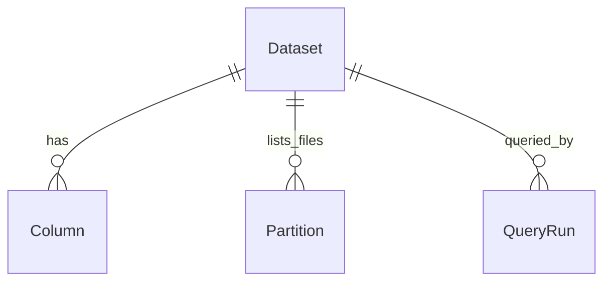
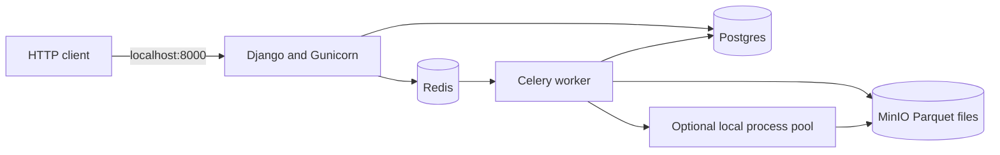

# Learn this repo from zero: backend and infrastructure

This guide assumes you are new to backend development. Open the linked source files beside this guide. Read one chapter, run its small example, and then continue. You do not need to understand Docker before you understand the engine.

This describes the current working-tree code. Examples explain its actual implementation, including places where comments or older documentation promise more than the code currently does. It covers backend and infrastructure; HTML, CSS, and browser design are outside the scope.

## Contents

1. [The idea in everyday language](#1-the-idea-in-everyday-language)
2. [Words and Python syntax you need](#2-words-and-python-syntax-you-need)
3. [The folders and libraries](#3-the-folders-and-libraries)
4. [Run it on Windows](#4-run-it-on-windows)
5. [Follow one complete request](#5-follow-one-complete-request)
6. [The engine, file by file](#6-the-engine-file-by-file)
7. [The catalog: remembering datasets](#7-the-catalog-remembering-datasets)
8. [Queries: remembering and running jobs](#8-queries-remembering-and-running-jobs)
9. [Django startup and configuration](#9-django-startup-and-configuration)
10. [Docker and the five services](#10-docker-and-the-five-services)
11. [Scripts, tests, and debugging](#11-scripts-tests-and-debugging)
12. [A learning path and exercises](#12-a-learning-path-and-exercises)

## 1. The idea in everyday language

Imagine a cupboard containing many notebooks. Each notebook contains taxi trips. You ask: "How much money did European trips earn when the price was above 50?"

A slow approach reads every page of every notebook. This engine tries three shortcuts:

1. The folder label says `region=EU`, so ignore folders for other regions.
2. A summary says all prices on a particular block of pages are below 50, so ignore that block.
3. You only need prices, so ignore unrelated columns such as passenger count.

Here, the notebooks are **Parquet files**, the page blocks are **row groups**, and the summaries are **footer statistics**.

The SQL question is:

```sql
SELECT region, SUM(price) AS revenue
FROM trips
WHERE region = 'EU' AND price > 50
GROUP BY region
```

There are two systems working together:

- **The engine** understands the question and reads the files. It is ordinary Python, independent of Django.
- **The control plane** is the Django application. It remembers dataset locations, accepts questions, starts jobs, and records results.

### Three places data can live

| Place | What it holds | Everyday analogy |
|---|---|---|
| Local files or MinIO/S3 | Actual trip rows in Parquet | The notebooks |
| SQLite or Postgres | Dataset descriptions, users, query history, result previews | A register of notebooks and questions |
| Redis | Queued task messages, Celery results, cached footer metadata | A work tray and reusable sticky notes |

Postgres normally does **not** contain the trip rows. Registering a dataset records where its files are; it does not import all their rows into Postgres.

## 2. Words and Python syntax you need

### Backend vocabulary

| Word | Meaning here |
|---|---|
| Request | A message sent to the server, usually over HTTP |
| Endpoint | A URL that accepts a particular kind of request |
| API | A defined way to call functionality; it can be HTTP or a Python function |
| JSON | A text format for objects, lists, numbers, strings, booleans, and null |
| Schema | Names and types of columns |
| URI | A location such as `./data/trips` or `s3://trips/trips` |
| ORM | Django's interface for database operations using Python objects |
| Model | A Python class describing a database table |
| Migration | Instructions to create or change database tables |
| Serializer | Converts model data to API data and defines exposed fields |
| Task | Work that can run immediately or be sent to a background worker |
| Broker | The service carrying task messages; Redis fills that role here |
| Process | A running program with its own memory |
| Cache | A temporary copy of information that is expensive to retrieve |
| Predicate | A true/false condition, such as `price > 50` |
| Projection | Selecting columns; `SELECT price` projects `price` |
| Pruning | Skipping files or row groups that cannot contribute |
| Pushdown | Moving a decision closer to the scan so it happens earlier |
| Logical plan | A tree describing what operations the query needs |
| Physical plan | Concrete files, row groups, and columns to read |
| Aggregate | A calculation across rows, such as `SUM` or `AVG` |
| Partition | A folder label grouping data, such as `region=EU` |
| Footer | Metadata near the end of a Parquet file |

### Python patterns you will keep seeing

```python
from .parser import parse_sql
```

The dot means "from this package." A package is a folder Python can import. `__init__.py` commonly marks or initializes that package.

```python
def run_sql(sql: str, max_workers: int | None = None) -> QueryResult:
```

`def` defines a function. `sql: str` documents that SQL should be a string. `int | None` means an integer or no value. `= None` supplies a default. `-> QueryResult` documents the returned type. Type hints help readers and tooling; they do not automatically validate every value at runtime.

```python
@dataclass
class DatasetSchema:
    columns: list[str]
    partition_columns: list[str] = field(default_factory=list)
```

A class describes an object. `@dataclass` generates routine methods such as its constructor. `default_factory=list` gives every object its own empty list. Sharing one mutable default list between objects would be a bug.

```python
@property
def column_names(self):
    ...
```

A property is calculated by a function but accessed like `dataset.column_names`. `self` is the particular object being used.

Other common patterns:

- `@shared_task`: register a function with Celery.
- `@action`: add a custom REST endpoint to a Django REST Framework viewset.
- `_helper`: leading underscore means an internal helper by convention.
- `try / except`: attempt work and handle an error.
- `with fs.open_input_file(...)`: open a resource and close it when the block ends.
- `yield`: produce one item at a time rather than returning a whole list immediately.
- `[f for f in files if ...]`: build a list from matching items.
- `{c for c in columns}`: build a set, useful for unique values and membership checks.
- `cols <= part_cols`: with sets, means all `cols` belong to `part_cols`.
- `needed |= other`: add another set's members to `needed`.
- `children=[node]`: make an operation point to the operation providing its input.
- `from __future__ import annotations`: postpone evaluation of type annotations, useful when types refer to each other.
- `if __name__ == '__main__'`: run the block when executing this file directly, rather than importing it.

## 3. The folders and libraries

```text
manage.py                    Django command launcher
pyproject.toml               Dependencies and tool configuration
apps/
  engine/                    SQL-to-results pipeline
  catalog/                   Registered dataset metadata
  queries/                   Query records, task dispatch, cache
  frontend/                  Server-side page request handlers too
config/
  settings/                  Development and production configuration
  urls.py                    URL routing
  celery.py                  Background-job application
  wsgi.py / asgi.py           Server entrypoints
scripts/                     Generate, upload, benchmark data
tests/                       Automated examples and correctness checks
Dockerfile                   Recipe for one application image
docker-compose.yml           Runs the image alongside other services
.env.example                 Example configuration values
.dockerignore                Files omitted when building an image
docs/DEPLOY.md               Existing deployment notes
```

### Who does what?

| Library | Job |
|---|---|
| Django | HTTP application, ORM, users, admin, settings |
| Django REST Framework | JSON API serializers, viewsets, routers |
| sqlglot | Turn SQL text into a syntax tree |
| PyArrow | Access filesystems, Parquet metadata, column data, filter expressions |
| Polars | In-memory filtering results, grouping, aggregate merging, sorting |
| Celery | Run query jobs inline or through a worker |
| redis Python package | Talk to Redis for footer metadata caching |
| psycopg | PostgreSQL driver |
| Gunicorn | Serve the Django WSGI application in containers |
| WhiteNoise | Serve collected static files |
| pytest / pytest-django | Run tests and initialize Django for them |
| DuckDB | Compare answers and benchmark performance |

Read [pyproject.toml](pyproject.toml) for the declared dependencies. The `dev` extra adds testing tools. Ruff settings set Python 3.11 as the target and a 100-character line length.

## 4. Run it on Windows

Start with local files, SQLite, and inline Celery. This reduces the number of new concepts you need at once.

From the repo root in PowerShell, with Python 3.11 or newer:

```powershell
# Create only if you do not already have .venv.
python -m venv .venv

# Install the project and its development tools.
.\.venv\Scripts\python.exe -m pip install -e ".[dev]"

# Generate a small learning dataset at a new location.
.\.venv\Scripts\python.exe scripts/seed_data.py --out ./data/learning_trips --rows 300000 --days 5

# Create the application's database tables.
.\.venv\Scripts\python.exe manage.py migrate

# Remember where the dataset lives.
.\.venv\Scripts\python.exe manage.py register_dataset learning-trips ./data/learning_trips

# Optional: create an account for /admin/.
.\.venv\Scripts\python.exe manage.py createsuperuser

# Keep this terminal running.
.\.venv\Scripts\python.exe manage.py runserver
```

`-e` installs in editable mode: importing the project uses your checkout. `[dev]` includes the extra test dependencies. Calling the virtual environment's Python explicitly avoids needing to activate it.

These commands write sample files and application database records. Use a new output directory if you want to preserve existing sample data.

The local fallback requires `POSTGRES_HOST` and `REDIS_URL` to be unset. Settings read the process environment with `os.environ`; they do **not** load `.env` automatically. Copying `.env.example` to `.env` alone does not configure `manage.py`.

You can set a value for commands launched from the current PowerShell session:

```powershell
$env:ENGINE_MAX_WORKERS = "1"
```

### Ask a question without any HTTP server

This command assumes the sample directory above exists:

```powershell
.\.venv\Scripts\python.exe -c "from apps.engine.api import run_sql; r = run_sql('SELECT region, SUM(price) AS revenue FROM trips GROUP BY region', './data/learning_trips', max_workers=1); print(r.rows); print(r.plan_text); print(r.metrics)"
```

The engine API receives the dataset URI explicitly. `FROM trips` supplies the plan's dataset label; the engine does not look up that name in Django. The HTTP caller selects a registered dataset separately. This also means the current engine does not verify that the `FROM` name matches the selected catalog record.

## 5. Follow one complete request

### The full backend flow

```mermaid
sequenceDiagram
    participant Client
    participant Web as Django API
    participant DB as SQLite or Postgres
    participant Queue as Redis broker
    participant Worker as Celery task
    participant Engine as Python engine
    participant Files as Parquet storage
    Client->>Web: POST dataset id and SQL
    Web->>DB: Create pending QueryRun
    alt REDIS_URL configured
        Web->>Queue: Send run_query(run.id)
        Queue->>Worker: Deliver task
    else Local eager mode
        Web->>Worker: Execute task inline
    end
    Worker->>DB: Set running; load dataset schema
    Worker->>Engine: run_sql(sql, URI, schema)
    Engine->>Files: List files, inspect kept footers, read selected chunks
    Files-->>Engine: Column data
    Engine-->>Worker: Rows, plan, metrics
    Worker->>DB: Save success and preview, or error
    Client->>Web: GET query run status
    Web->>DB: Read QueryRun
    Web-->>Client: Status, result preview, metrics
```

### 5.1 Register the dataset first

An HTTP registration supplies a name and URI:

```json
{"name": "learning-trips", "uri": "./data/learning_trips"}
```

`POST /api/catalog/datasets/` calls `DatasetViewSet.create()` in [apps/catalog/api.py](apps/catalog/api.py). It calls `register_dataset()` in [services.py](apps/catalog/services.py). That lists files, reads one sample schema, and creates metadata records in the application database.

### 5.2 Submit SQL

`POST /api/queries/runs/` accepts:

```json
{
  "dataset": 1,
  "sql": "SELECT region, SUM(price) AS revenue FROM trips WHERE region = 'EU' AND price > 50 GROUP BY region"
}
```

Replace `1` with your actual dataset id. `QueryRunViewSet.create()` checks the required fields, looks up the dataset, creates a pending record, and calls `run_query.delay(run.id)`.

`.delay()` means "dispatch this Celery task." With Redis configured, the task runs elsewhere. Without Redis, eager mode runs it in the current process before `.delay()` returns.

### 5.3 Run the task

`run_query()` loads the record and dataset using `select_related`, marks it running, constructs the engine schema, and calls `run_sql()`.

`run_sql()` builds the plan, prunes work, executes tasks, and returns a `QueryResult`. The Celery task stores the plan, metrics, total returned-row count, and up to 200 preview rows. An engine exception becomes an error record.

### 5.4 Read the record

`GET /api/queries/runs/1/` reads the persisted record. In background mode the create response can still show pending or running. In eager mode it commonly already shows success or error.

The browser's form-based route does similar backend work through `submit_query()` in [apps/frontend/views.py](apps/frontend/views.py). Its status endpoint reads the same database record. This is why the folder named `frontend` also contains Python backend request handlers.

## 6. The engine, file by file

### 6.1 `apps/engine/api.py`: the front door

Open [api.py](apps/engine/api.py). Start here because it connects all the smaller pieces.

| Object or function | Purpose |
|---|---|
| `DatasetSchema` | Column names plus partition-column names |
| `QueryResult` | Final columns, rows, metrics, plan text/diagram, duration |
| `infer_schema()` | List storage, use one file's metadata and path to infer names |
| `plan_sql()` | Parse SQL and run the optimizer |
| `explain_sql()` | Return the optimized logical plan without executing |
| `run_sql()` | Run the complete pipeline |

The main function follows this order:

```text
Start timer
  -> plan_sql(sql, URI, schema)
  -> find_scan(plan)
  -> resolve_fs(URI)
  -> build_physical_plan(scan, filesystem, base)
  -> execute(plan, URI, tasks, metrics)
  -> assemble QueryResult
```

`schema = schema or infer_schema(dataset_uri)` means use the provided schema, otherwise infer one from storage. Django normally supplies one from catalog records.

`metadata_fn=read_row_group_metadata` is a replaceable function argument. Django substitutes its cached version. The engine does not need to know Redis exists. This pattern is **dependency injection**: a caller supplies a dependency instead of the implementation hardcoding it.

`explain_sql()` produces an optimized logical plan, not a full physical scan plan. With a supplied catalog schema it does not inspect storage. Without a schema it may list files and read a sample footer.

### 6.2 `logical_plan.py`: boxes describing work

Open [logical_plan.py](apps/engine/logical_plan.py).

| Class | Meaning | Important fields |
|---|---|---|
| `LogicalNode` | Common interface for plan nodes | `children`, `describe()` |
| `Scan` | Read the selected dataset | dataset, projection, pushed filter, partition filter |
| `Filter` | Keep matching rows | predicate, input child |
| `Project` | Choose output columns or expressions | pairs of output name and source expression |
| `AggregateExpr` | One aggregate instruction | function, input column, output name |
| `Aggregate` | Group rows and compute aggregates | group keys, aggregate instructions, output order |
| `Sort` | Order results | column and descending flag pairs |
| `Limit` | Keep at most N results | `n` |

For the running example, the parser returns this tree:

```text
Aggregate: group by region, sum price into revenue
  Filter: region = EU AND price > 50
    Scan: trips
```

Read the tree from the bottom for data flow: scan first, then filter, then aggregate. The root is the last operation. `Project` and `Aggregate` are alternative branches in the parser; not every node appears in every query.

`walk()` recursively yields each node, starting with the current node. `find_scan()` uses that traversal to locate the scan. `format_plan()` recursively builds indented text. `to_mermaid()` gives nodes identifiers and turns their relationships into diagram text. These functions describe a plan; they do not execute it.

### 6.3 `parser.py`: translate SQL into our objects

Open [parser.py](apps/engine/parser.py).

Parsing has two layers:

1. `sqlglot.parse_one(..., read='duckdb')` understands SQL grammar and returns an AST, an abstract syntax tree.
2. This module converts the supported parts of that AST into the project's own plan classes.

`parse_sql()` starts with a `Scan`. It wraps that scan with a `Filter` when there is a `WHERE`. Then it chooses aggregate or projection. It adds `Sort` and `Limit` last when present.

| Helper | What to look for |
|---|---|
| `ParseError` | A clear error type for unsupported or malformed input |
| `_extract_dataset()` | Extracts the table name from `FROM` |
| `_has_aggregate()` | Walks selected expressions looking for aggregate functions |
| `_build_aggregate()` | Records group keys, aggregate functions, aliases, output order |
| `_default_agg_name()` | Names an unaliased output, for example `count_star` |
| `_build_project()` | Records selected columns, aliases, or scalar SQL expressions |
| `_to_predicate()` | Builds comparison, AND, OR, NOT, IN, and BETWEEN predicate objects |
| `_column_and_literal()` | Pulls a column and literal out of a comparison |
| `_col_name()` | Extracts a supported column identifier |
| `_literal_value()` | Converts syntax-tree values into Python values |
| `_maybe_date()` | Attempts date/datetime conversion for cast string literals |

Example: `SUM(price) AS revenue` becomes approximately:

```python
AggregateExpr(func="sum", column="price", output="revenue")
```

`BETWEEN 10 AND 20` becomes two comparisons joined by AND. `COUNT(*)` uses `column=None` to represent counting rows rather than values in a particular column.

The parser intentionally handles a limited SQL subset. Parsing successfully with sqlglot does not mean this engine implements every SQL feature. Joins, subqueries, advanced aggregates, and general SQL validation are outside its intended supported scope.

### 6.4 `predicates.py`: conditions we can inspect

Open [predicates.py](apps/engine/predicates.py).

Why not keep `WHERE` as a string? Because the planner needs to ask questions about it before reading rows.

Each predicate provides three operations:

1. `columns()`: which columns does this condition depend on?
2. `to_arrow()`: convert it into a PyArrow expression for filtering real rows.
3. `can_skip_row_group(stats)`: do the summaries prove this entire group cannot match?

`ColumnStats` stores minimum, maximum, null count, and value count. Its `all_null` property checks whether both min and max are absent; missing statistics can also produce absent min/max, so do not treat that helper as proof of all-null data in every context.

For `price > 50`, a row group with `max(price)=40` can be skipped. A group with range 20 to 100 must be read because some rows might match. Missing statistics means keep the group.

| Comparison | Safe reason to skip |
|---|---|
| `x = v` | v is outside the group's min/max range |
| `x > v` | group maximum is at most v |
| `x >= v` | group maximum is below v |
| `x < v` | group minimum is at least v |
| `x <= v` | group minimum is above v |
| `x != v` | minimum and maximum both equal v |

`In` can skip when every requested value is outside the range. `And` can skip if any child is impossible. `Or` can skip only if all children are impossible. `Not` conservatively declines statistics-based skipping.

`split_conjuncts()` flattens top-level AND conditions. `conjoin()` rebuilds a condition from a list. `normalize_value()` currently returns its input unchanged; it is not a general type-conversion system.

### 6.5 `optimizer.py`: move work earlier

Open [optimizer.py](apps/engine/optimizer.py).

This is a **rule-based** optimizer. It applies fixed rules; it does not compare thousands of possible plans using a cost model.

`OptimizerContext` provides all column names and partition column names. `optimize()` pushes conditions into the scan, then decides its projection.

For our example:

```text
Before:
  Aggregate
    Filter(region = EU AND price > 50)
      Scan

After:
  Aggregate
    Scan
      partition_filter = region = EU
      pushed_filter    = price > 50
      projection       = [price]
```

`_pushdown_predicates()` splits the AND. A condition that references only partition columns becomes a partition filter. Other conditions become a pushed data filter. `_filter_above_scan()` finds the filter; `_remove_node()` removes it after the scan takes responsibility for its conditions.

`_pushdown_projection()` collects columns needed by selected outputs, grouping, aggregates, ordering, and filters. It excludes partition columns because those come from paths. `_columns_in_expr()` uses identifier tokens to identify referenced columns in scalar expressions; it is a simple heuristic, not a full expression validator.

There are three different projection states:

| Value | Meaning |
|---|---|
| `None` | Read all physical columns, as for `SELECT *` |
| `["price"]` | Read the named physical columns |
| `[]` | No physical column is referenced; physical planning chooses one to count rows |

For `COUNT(*)`, the engine still reads a narrow column. It does not currently answer the count entirely from footer row counts.

`collect_referenced_columns()` is a helper for inspecting plan references, used for explanatory/testing purposes. It is not the full projection-pushdown implementation.

### 6.6 `parquet_reader.py`: everything that touches storage

Open [parquet_reader.py](apps/engine/parquet_reader.py).

`ParquetFileInfo` holds a path, file size, and partition values. `RowGroupInfo` holds an index, row count, per-column compressed sizes, and statistics.

`resolve_fs()` turns a URI into a filesystem object and base path:

- Local paths use `LocalFileSystem`; Windows drive letters are handled as paths.
- `s3://bucket/prefix` uses `S3FileSystem`.
- `AWS_ENDPOINT_URL` redirects S3 access to an endpoint such as MinIO.
- Credentials and region are read from environment variables when supplied.

`list_files()` recursively lists `.parquet` files. `_HIVE_RE` extracts `key=value` labels from parent directories. `_coerce_partition_types()` and `_coerce_scalar()` attempt integer and float conversion, otherwise preserving strings. Date folder values remain strings here.

Example:

```text
data/trips/region=EU/date=2024-01-01/part.parquet
```

becomes partition information like:

```python
{"region": "EU", "date": "2024-01-01"}
```

`prune_files()` evaluates partition conditions against those labels using `_partition_matches()` and `_cmp()`. No file contents are needed for that decision, although obtaining the file listing itself can involve storage/network work.

`read_row_group_metadata()` opens a file and reads its Parquet metadata. For each row group it extracts row count, column compressed sizes, and available min/max statistics. Columns lacking statistics get placeholder `ColumnStats(None, None)` objects.

`read_row_groups()` performs the actual data read:

```python
table = pf.read_row_groups(row_group_indices, columns=columns)
if arrow_filter is not None:
    table = table.filter(arrow_filter)
```

This ordering matters. The engine first skips impossible row groups using metadata. It then reads selected column chunks from surviving groups, and applies the exact condition to the resulting Arrow table. The exact row predicate is not passed into `pf.read_row_groups()` as a storage-level filter.

### 6.7 `physical_plan.py`: make a work list

Open [physical_plan.py](apps/engine/physical_plan.py).

`ScanTask` is a worker's instruction sheet:

```text
path       = one file
row_groups = indices of surviving row groups in that file
columns    = columns to read
predicate  = exact data condition
partitions = constant values from the file's path
```

The current implementation creates **one task per surviving file**, containing all its surviving row groups. It does not create a separate process or task for every individual group.

`PhysicalPlan` contains tasks and a `ScanMetrics` object. `build_physical_plan()`:

1. Lists all files from storage.
2. Prunes files by partition conditions.
3. Adds an opaque pruned-file entry to `scan_map` without opening that file's footer.
4. Gets metadata for each kept file through the supplied `metadata_fn`.
5. If projection is empty, `_narrowest_column()` chooses the smallest compressed column from the first available row group's metadata and reuses that choice.
6. Tests each row group against min/max statistics.
7. Records skipped groups and kept groups.
8. Calculates planned column bytes and creates a task when some groups remain.
9. Adds pruned-file sizes to the baseline byte total.

`_projected_bytes()` sums the selected column chunk sizes. `_pruned_file_bytes()` uses listed whole-file sizes for pruned files. `_label()` makes readable labels for the scan map.

#### Read metrics carefully

| Metric | Actual meaning |
|---|---|
| `files_pruned` | Files eliminated by partition filtering |
| `files_scanned` | Files kept by partition pruning; some may later have all groups skipped |
| `total_row_groups` | Groups counted in kept files whose metadata was inspected |
| `row_groups_scanned` | Groups selected for reading |
| `rows_scanned` | Metadata row counts of selected groups, before exact row filtering |
| `columns_projected` | Number of selected physical columns |
| `bytes_scanned` | Sum of selected compressed column chunk sizes |
| `bytes_total` | Kept files' compressed chunks plus whole-file sizes of partition-pruned files |
| `scan_map` | Per-file and per-group read/skip outcomes |

These byte numbers are planning/accounting metrics. They do not measure all network traffic, filesystem calls, footer overhead, or process memory. For kept files the code sums column chunks; for pruned files it uses whole-file size. That is a small accounting difference worth understanding.

The accounting breakdown is designed to satisfy:

```text
bytes_total = bytes_scanned
            + bytes_pruned_files
            + bytes_pruned_row_groups
            + bytes_unprojected
```

`ScanMetrics.as_dict()` turns these values into ordinary data for storage and API responses.

### 6.8 `executor.py`: do the work and combine it

Open [executor.py](apps/engine/executor.py).

Start at `execute()`. It decides worker count, chooses aggregation or plain scan, then sorts, limits, converts to dictionaries, and returns `ExecResult`.

#### Read one task

`_read_task()` resolves the filesystem, converts the predicate to Arrow, reads selected row groups, converts the Arrow table into a Polars DataFrame, and adds partition columns as constants.

Every row from a file under `region=EU` gets an in-memory `region='EU'` value. That is how grouping on `region` works even though it was not stored as a physical column.

#### Aggregation has two stages

`_worker_aggregate()` calls `_partial_aggregate()` and serializes its small grouped result into bytes. `_run_aggregate()` dispatches those workers, deserializes the returned bytes, and calls `_merge_aggregate()`.

| SQL aggregate | Worker returns | Coordinator does |
|---|---|---|
| `COUNT(*)` | Row count | Add counts |
| `COUNT(price)` | Non-null price count | Add counts |
| `SUM(price)` | Sum and non-null count | Add sums, return null if all values were null |
| `MIN(price)` | Minimum | Minimum of minima |
| `MAX(price)` | Maximum | Maximum of maxima |
| `AVG(price)` | Sum and non-null count | Total sum / total count |

Why keep two numbers for averages? Suppose worker A has values 10 and 20; worker B has value 100. Their averages are 15 and 100. Averaging those produces 57.5, which is wrong. The correct answer is `(30 + 100) / (2 + 1)`, about 43.33.

Temporary names such as `revenue__sum` and `revenue__sumcnt` identify merge state. `_merge_aggregate()` turns them into the final `revenue` column.

NULL is a missing SQL value. `COUNT(*)` counts rows; `COUNT(column)` counts non-null values. A sum or average of all-null values should be null. Polars can return zero for a sum of no values, so this code carries non-null counts to restore SQL behavior.

#### Plain selects

`_worker_scan()` returns serialized filtered data. `_run_scan()` deserializes and concatenates frames. `_apply_projection()` selects columns, renames aliases, or evaluates a scalar expression using `pl.sql_expr()`.

`_apply_sort()` sorts the completed result. `_apply_limit()` uses `head(n)`. LIMIT is applied **after scanning and combining**, so `LIMIT 10` does not by itself mean only ten source rows are read.

#### Parallel processes

`_decide_workers()` uses an explicit `max_workers` when provided. Otherwise it runs serially for one task or fewer than 2,000,000 planned scanned rows, and caps automatic parallelism by task count and CPU count.

`_map()` calls worker functions directly for serial work. For parallel work it uses `ProcessPoolExecutor`. Its broad exception handler retries work serially; it can catch more than just process-startup failures. `_buf()` wraps returned bytes in `BytesIO` for Polars deserialization. `_find()` locates a node of a specified class.

Worker functions are module-level functions because process execution needs serializable functions and arguments. Each process resolves its own filesystem. DataFrames are serialized for transfer between processes.

#### What this engine does not yet guarantee

Keep these implementation edges in mind as learning exercises:

- If no aggregate tasks survive at all, `_merge_aggregate()` returns an empty frame; global SQL aggregates such as an empty-input `COUNT(*)` normally need one output row.
- `_column_and_literal()` accepts reversed operands but does not reverse inequality operators; use `price > 50`, rather than `50 < price`, in learning examples.
- A mixed partition/data OR condition stays in `pushed_filter`, but the reader applies that expression before `_read_task()` materializes partition columns. Such queries need further handling.
- Plan validation is deliberately limited; unsupported clauses should not be assumed safe just because parsing succeeded.
- Final rows are materialized in memory. This is a single-machine teaching engine, not a distributed streaming query system.

These observations come from reading the implementation; this guide does not change those behaviors.

### 6.9 `results.py`: prepare values for JSON

Open [results.py](apps/engine/results.py).

`batches()` slices an existing list into chunks. `to_records()` builds an envelope containing columns, JSON-safe rows, and row count. `_json_safe()` processes each dictionary. `_coerce()` converts dates to ISO text, decimals to floats, and bytes to decoded text.

The existence of `batches()` does not mean queries stream directly from disk to the client. `execute()` already creates the complete list of rows. The Celery task currently uses `to_records()` for the stored preview.

## 7. The catalog: remembering datasets

### 7.1 `models.py`: database tables

Open [apps/catalog/models.py](apps/catalog/models.py).

`Dataset` holds a unique name, URI, description, optional owner, creation time, file count, and total listed file bytes. `column_names` and `partition_columns` query its related column records.

`Column` holds a dataset reference, name, Arrow type, partition flag, and position. Its `(dataset, name)` uniqueness rule prevents duplicate column names within one dataset. Position preserves display/schema ordering.

`Partition` holds a dataset reference, file path, partition-values JSON, and file size. Despite its name, registration creates one such record **per discovered file**, so several files can share the same partition values.



`ForeignKey` links one record to another. `on_delete=CASCADE` deletes dependent records when the referenced dataset is deleted. `SET_NULL` preserves the record while removing a deleted owner/user reference. `related_name='columns'` makes `dataset.columns` available.

### 7.2 `services.py`: registration logic

Open [apps/catalog/services.py](apps/catalog/services.py).

`register_dataset()` resolves storage, lists files, rejects an empty dataset, and reads the Arrow schema from one sample file. It then:

1. Creates or updates the dataset by its name using `update_or_create()`.
2. Deletes its previous column records and creates current ones.
3. Adds path partition columns, labelled as string in the catalog.
4. Deletes the old file inventory and bulk-creates current file records.

It does not validate every file for identical schema, and the multi-step refresh is not wrapped in a transaction in this function.

`engine_schema()` translates database metadata into the engine's `DatasetSchema`. It uses database queries, but does not read Parquet storage.

`preview_stats()` reads one registered file's footer and exposes a limited set of min/max values. `column_profile()` sums each column's compressed sizes across that sample file's row groups and reports widest/narrowest columns. These are sample-file views, not whole-dataset profiles. `_safe()` preserves JSON-compatible values or converts them to strings.

The catalog remembers an inventory, but physical planning still calls `list_files()` on storage for each execution. Catalog registration does not eliminate those listings.

### 7.3 `api.py`: HTTP access

Open [apps/catalog/api.py](apps/catalog/api.py).

`ColumnSerializer` exposes column metadata. `DatasetSerializer` exposes dataset metadata and nests its related columns. `DatasetViewSet` supplies standard model endpoints; its custom `create()` calls registration rather than merely inserting a dataset record. `reregister()` refreshes an existing dataset's metadata from storage.

`prefetch_related('columns')` fetches related columns efficiently for a list of datasets. A `DefaultRouter` generates URLs from the viewset.

| Endpoint | Purpose |
|---|---|
| `GET /api/catalog/datasets/` | List datasets |
| `POST /api/catalog/datasets/` | Register files at a URI |
| `GET /api/catalog/datasets/<id>/` | Read one dataset |
| `POST /api/catalog/datasets/<id>/reregister/` | Refresh its metadata |

Inherited update/delete endpoints also exist. Ordinary update does not automatically invoke the registration service; changing a URI is not the same as refreshing schema metadata.

### 7.4 Supporting files

- [management/commands/register_dataset.py](apps/catalog/management/commands/register_dataset.py): adds the `manage.py register_dataset` command, parses name/URI/description, calls the service, prints a summary, and converts expected registration failures to command errors.
- [admin.py](apps/catalog/admin.py): registers datasets and file inventory for Django admin; column records appear inline with datasets.
- [apps.py](apps/catalog/apps.py): identifies the Django application and its default id field type.
- [migrations/0001_initial.py](apps/catalog/migrations/0001_initial.py): creates catalog tables and relationships. `manage.py migrate` applies migration files in order.
- `__init__.py` files: package markers; they do not contain the registration pipeline.

## 8. Queries: remembering and running jobs

### 8.1 `models.py`: one question, one record

Open [apps/queries/models.py](apps/queries/models.py).

`QueryRun` stores the selected dataset, optional user, SQL, state, plan, timing, scan metrics, result column names, result preview, error, and timestamps. Runs default to newest-first ordering.

```text
pending -> running -> success
                   -> error
```

`Status` is a `TextChoices` enum, keeping allowed state strings in one place. The model defines choices; it is not a separate job scheduler.

`scan_ratio` returns `100 * bytes_scanned / bytes_total`, rounded to one decimal, or no value if the total is absent/zero. `scan_map` exposes the stored map only up to the 64-file cap. `scan_stages` formats the byte breakdown. `pruning_notes` turns counters into sentences. These properties explain already-recorded data; they do not run new queries.

### 8.2 `tasks.py`: orchestration

Open [apps/queries/tasks.py](apps/queries/tasks.py).

`PREVIEW_ROWS = 200` limits the stored preview. `run_query(run_id)`:

1. Fetches the run together with its dataset.
2. Saves `running`.
3. Builds the engine schema.
4. Calls `run_sql()` with the configured engine worker limit and cached metadata function.
5. On an exception inside that block, records error text and finish time.
6. On success, copies metrics, plan, timing, and output metadata onto the model.
7. Converts the first 200 result rows to JSON-safe records.
8. Saves success and finish time, then returns the run id.

The task fetch and initial state save occur before its try block; result conversion and the final save occur after it. Failures there are not all converted into an error state by the current handler. There is no explicit retry or crash-recovery policy in this task.

### 8.3 `api.py`: submit, inspect, explain

Open [apps/queries/api.py](apps/queries/api.py).

`QueryRunSerializer` exposes the run record, including dataset name and calculated scan ratio. Only dataset and SQL are writable serializer fields; most output fields are read-only.

`QueryRunViewSet.create()` manually reads request data, validates required dataset/SQL values, creates the record, dispatches the task, refreshes the model, and returns HTTP 201. This custom create path does not use the full serializer validation workflow.

`select_related('dataset')` joins the related dataset in the database query so reading `run.dataset` does not require another fetch for each run.

| Endpoint | Purpose |
|---|---|
| `GET /api/queries/runs/` | Query history |
| `POST /api/queries/runs/` | Submit SQL with a dataset id |
| `GET /api/queries/runs/<id>/` | Read state, preview, metrics, and errors |
| `POST /api/queries/runs/explain/` | Return the logical plan without execution |

Inherited update/delete operations also exist. Updating a run's SQL does not redispatch its task; submit a new run to execute new SQL.

### 8.4 `cache.py`: reuse file summaries

Open [apps/queries/cache.py](apps/queries/cache.py).

`_client()` creates and pings a Redis connection when `STATS_CACHE_URL` is configured. `cached_row_group_metadata()` uses a key shaped like:

```text
rgmeta:<file path>:<file size>
```

On a cache hit, it unpickles metadata. On a miss, it reads the actual footer and caches serialized metadata for 3,600 seconds. With no available initial connection, it reads the footer normally.

The implementation caches row-group metadata; it does not implement a file-listing cache despite the broader module description. A same-path, same-size rewrite can reuse stale metadata until expiry. The key also does not explicitly identify the filesystem/endpoint. The `client.get()` call is not inside a fallback try block, so a later Redis read failure can propagate.

Pickle is Python-specific object serialization. Use this cache with trusted Redis contents because unpickling can execute code. It is a backend cache format, not a client data format.

### 8.5 Supporting files and page handlers

- [admin.py](apps/queries/admin.py): query history in Django admin; makes output fields read-only there.
- [apps.py](apps/queries/apps.py): Django application configuration.
- [migrations/0001_initial.py](apps/queries/migrations/0001_initial.py): creates query records and foreign keys.
- `__init__.py`: package initialization.
- [apps/frontend/views.py](apps/frontend/views.py): `submit_query` dispatches form submissions; `rerun_query` creates a new run from old SQL; `query_run_status` reads progress; `explain_query` returns the same engine plan through a page handler. Other handlers query metadata and history for pages.
- [apps/frontend/history.py](apps/frontend/history.py): parses history filters and builds database queries.
- [apps/frontend/metrics.py](apps/frontend/metrics.py): builds dashboard/performance summaries from stored runs and benchmark output.
- [apps/frontend/demos.py](apps/frontend/demos.py): builds explanatory sample SQL from dataset metadata.

## 9. Django startup and configuration

### 9.1 Entry points

| File | Role |
|---|---|
| [manage.py](manage.py) | Pass command-line arguments to Django; defaults to development settings |
| [config/urls.py](config/urls.py) | Routes incoming URL paths to APIs, admin, or page handlers |
| [config/wsgi.py](config/wsgi.py) | Exposes `application` for a WSGI server such as Gunicorn |
| [config/asgi.py](config/asgi.py) | Exposes `application` for an ASGI server |
| [config/celery.py](config/celery.py) | Creates Celery app, loads Django's `CELERY_` settings, discovers tasks |
| [config/__init__.py](config/__init__.py) | Imports/exports the Celery application |

WSGI and ASGI are interfaces between an HTTP server and Python application. Compose uses WSGI/Gunicorn here; an ASGI file alone does not mean the app implements websocket query streaming.

`os.environ.setdefault()` supplies a setting only if nothing set it already. Importing `config` imports its Celery app, which itself defaults `DJANGO_SETTINGS_MODULE` to development settings. WSGI/ASGI files request production defaults too, but explicit environment configuration is the dependable way to select production settings. Compose explicitly supplies `config.settings.prod`.

### 9.2 `settings/base.py`

Open [base.py](config/settings/base.py).

- `BASE_DIR` finds the repo root from the settings file's location.
- `env()` reads an environment variable or a default.
- `env_bool()` recognizes `1`, `true`, `yes`, and `on` as true.
- `INSTALLED_APPS` enables Django built-ins and the project's applications.
- `MIDDLEWARE` runs request/response processing: security, static files, sessions, CSRF, authentication, messages, and frame protection.
- `ROOT_URLCONF` chooses the route table.
- `TEMPLATES` tells Django where templates live and which context helpers to use.
- `DATABASES` selects Postgres when `POSTGRES_HOST` exists, otherwise repo-local SQLite.
- UTC/timezone settings control timestamp handling.
- Static-file settings define source and collected output directories; WhiteNoise serves collected assets.
- REST Framework settings currently allow any user by default and enable JSON plus browsable API rendering.
- Celery settings choose Redis or in-memory broker/results and set eager execution without Redis.
- `STATS_CACHE_URL` reuses the Redis URL for metadata caching.
- `ENGINE_MAX_WORKERS` parses an integer; zero/unset becomes `None`, allowing automatic decisions.

### 9.3 Development and production differences

[dev.py](config/settings/dev.py) imports base settings and forces `DEBUG=True`. [prod.py](config/settings/prod.py) imports base settings and forces `DEBUG=False`, trusts the configured forwarded HTTPS header, and marks session/CSRF cookies secure.

Consequences:

- Setting `DJANGO_DEBUG=false` while using `dev.py` still leaves debug on.
- Compose's `DJANGO_DEBUG=true` default does not override `prod.py`'s final `DEBUG=False`.
- Secure cookies need HTTPS for normal browser login/admin behavior. Plain HTTP API experiments and authenticated browser sessions have different requirements.

### 9.4 Environment variables

| Variable | What consumes it | Effect |
|---|---|---|
| `DJANGO_SETTINGS_MODULE` | Django/Celery startup | Chooses dev or prod module |
| `DJANGO_SECRET_KEY` | Base settings | Django signing secret |
| `DJANGO_ALLOWED_HOSTS` | Base settings | Comma-separated allowed hostnames |
| `DJANGO_DEBUG` | Base settings | Initial debug value; dev/prod override it |
| `POSTGRES_HOST` | Base settings | Enables Postgres instead of SQLite |
| `POSTGRES_DB`, `POSTGRES_USER`, `POSTGRES_PASSWORD`, `POSTGRES_PORT` | Base settings | Database connection values |
| `REDIS_URL` | Base settings | Enables background Celery and stats cache |
| `AWS_ENDPOINT_URL` | Storage layer | Custom S3 endpoint, typically MinIO |
| `AWS_ACCESS_KEY_ID`, `AWS_SECRET_ACCESS_KEY` | Storage layer | Object-storage credentials |
| `AWS_REGION` | Storage layer | Object-storage region |
| `ENGINE_MAX_WORKERS` | Settings/task/executor | Inner query process limit |

`.env.example` is documentation. Docker Compose reads `.env` for `${...}` substitution, but it only passes values that its service configuration actually includes. Local Python does not load that file itself. Several Compose values, including MinIO and Postgres credentials, are currently hardcoded in YAML.

## 10. Docker and the five services

### 10.1 Image, container, volume, port

An **image** is a packaged program and dependencies. A **container** is a running instance of that image. A **volume** stores files separately from a container's disposable filesystem. A **port mapping** lets your computer reach a port inside a container.

An image is like a recipe plus prepared ingredients; a container is one kitchen using them. Multiple containers can use the same image and run different commands.

### 10.2 `Dockerfile`, instruction by instruction

Open [Dockerfile](Dockerfile).

| Instruction | Explanation |
|---|---|
| `FROM python:3.12-slim` | Start with a small Linux image containing Python |
| `ENV PYTHONUNBUFFERED=1` | Print logs promptly |
| `PYTHONDONTWRITEBYTECODE=1` | Avoid writing Python bytecode files |
| `PIP_NO_CACHE_DIR=1` | Avoid storing pip download cache |
| `WORKDIR /app` | Subsequent commands run from `/app` |
| `COPY pyproject.toml ./` | Copy dependency metadata first |
| `RUN pip install ...` | Install the explicitly listed dependencies |
| `COPY . .` | Copy the remaining non-ignored checkout |
| `EXPOSE 8000` | Document the application port; does not publish it by itself |
| `CMD [...]` | Default to running Gunicorn |

Copying dependency metadata before source allows Docker to reuse the dependency layer when source changes. However, the Dockerfile currently installs a manual dependency list; it does not use `pip install -e .` or install every extra in `pyproject.toml`. Those lists can drift.

[.dockerignore](.dockerignore) excludes the virtual environment, local data, SQLite files, Git metadata, caches, collected static files, and benchmark results. **Local `data/` is not baked into the image.**

### 10.3 `docker-compose.yml`: five connected containers

Open [docker-compose.yml](docker-compose.yml).

| Service | Main job | Host port | Persistent volume |
|---|---|---|---|
| `web` | Django HTTP API via Gunicorn | 8000 | None declared |
| `worker` | Celery query jobs | None | None declared |
| `postgres` | App database | 5432 | `pg_data` |
| `redis` | Broker, task results, footer cache | 6379 | None declared |
| `minio` | S3-compatible Parquet storage | 9000; console 9001 | `minio_data` |

Compose creates a network where service names resolve to containers. Inside `web`, the database hostname is `postgres`, Redis is `redis`, and the object store is `minio`.

`localhost` inside `web` means the web container itself. On your Windows host, `http://localhost:9000` reaches the published MinIO port. Inside `web` or `worker`, use `http://minio:9000`.



#### Web startup command

```text
python manage.py migrate
  AND python manage.py collectstatic --noinput
  AND gunicorn config.wsgi:application --bind 0.0.0.0:8000 --workers 3
```

The shell `&&` means proceed only if the previous command succeeds. Migrate prepares database tables. Collectstatic gathers static assets. Gunicorn then starts three web worker processes.

#### Worker command

```text
celery -A config worker --loglevel=info --concurrency=2
```

`-A config` finds the Celery application exported by the config package. `--concurrency=2` allows two Celery worker execution slots under its default pool.

There are three different worker counts:

1. Gunicorn's three workers handle HTTP requests.
2. Celery's two worker slots run query jobs.
3. A query's `ProcessPoolExecutor` can create additional processes for scans.

These are separate layers. Increasing all counts can multiply memory/CPU demand. Celery's default prefork environment can also restrict nested child-process creation; the executor has serial fallback. Do not assume every background query uses an inner process pool.

#### Shared environment and startup ordering

`&engine_env` gives a YAML mapping a name. `*engine_env` reuses that mapping for the worker. Both processes get the same database, Redis, and storage settings.

Postgres has a readiness healthcheck. Web waits for it to be healthy. Redis and MinIO are dependencies marked started rather than healthy for web. Worker depends on web starting, not on a dedicated "web migrations finished" condition. Startup order is not a complete readiness guarantee.

Named volumes persist Postgres and MinIO files across normal container recreation. Redis has no persistence volume declared. Web/worker files created at runtime are not shared or durable through a named volume in the current Compose file.

### 10.4 A working learning flow with shared MinIO data

Because `data/` is excluded from the image and web/worker have separate filesystems, generating files only in web and registering a local path is insufficient for the worker. Put the dataset in MinIO so both containers can access it.

Run these manually from the repo root after installing Docker Desktop:

```powershell
docker compose up -d --build
docker compose ps
docker compose logs web worker
```

Wait until migrations finish and services are ready, then:

```powershell
# Generate files inside web, solely as a staging directory.
docker compose exec web python scripts/seed_data.py --out /app/data/learning_trips --rows 300000 --days 5

# Upload them to the shared MinIO service using the container's configured endpoint.
docker compose exec web python scripts/upload_minio.py --src /app/data/learning_trips --bucket learning-trips --prefix trips

# Register the shared location, which the worker can also read.
docker compose exec web python manage.py register_dataset learning-trips s3://learning-trips/trips
```

You can now submit SQL through `http://localhost:8000/api/queries/runs/`. MinIO's console is at `http://localhost:9001`. The sample YAML uses `minioadmin` as both MinIO username and password.

An alternative is a shared bind mount attached to both web and worker at the same container path. That requires editing Compose; the commands above work with its current object-storage arrangement.

### 10.5 Useful operational commands

```powershell
docker compose ps
docker compose logs --tail 100 web worker
docker compose logs -f worker
docker compose exec web python manage.py check
docker compose exec web python manage.py showmigrations
docker compose restart worker
docker compose down
```

`down` removes containers and their network while keeping named volumes by default. `down -v` also removes the named volumes and their stored data; do not use it as a routine restart.

### 10.6 Understanding deployment without cloud marketing

The architecture can run on one VM: install Docker, provide persistent storage, run the services, and put an HTTPS reverse proxy in front of web. A reverse proxy accepts public traffic and forwards it to the application. The current Compose file does not include that proxy.

[docs/DEPLOY.md](docs/DEPLOY.md) contains older provider-specific recipes. This guide does not verify provider prices/free tiers. Also check recipes against the current code: editing `.env` cannot override hardcoded Compose AWS values, and `upload_minio.py` defaults to localhost MinIO rather than automatically selecting AWS when its endpoint variable is absent.

For a public deployment, current defaults need deliberate changes: REST permissions are `AllowAny`, infrastructure ports are published, credentials are demonstration values, and hostnames default broadly. Configure access control, secrets, HTTPS, and private service exposure before making this demo publicly writable. Those are concrete properties of this checkout, not features the engine implements for you.

## 11. Scripts, tests, and debugging

### 11.1 `scripts/seed_data.py`

[seed_data.py](scripts/seed_data.py) makes deterministic pseudo-random trip data. `gen_partition()` builds arrays, includes missing tips/payment values, constructs an Arrow table, creates directories, and writes Snappy-compressed Parquet with multiple row groups.

`main()` parses output directory, requested rows, and days. It creates all region/date pairs and writes one file per pair. With three regions and five days you get fifteen files. Integer division means actual generated rows can differ slightly from the request. Trip ids increase across files, giving selective id filters useful min/max ranges.

`region` and `date` exist in directory names, while `trip_id`, `pickup_hour`, `passengers`, `distance`, `price`, `tip`, and `payment` are physical file columns. The date generator is a simple January string formatter; keep learning examples within that month's valid day range.

### 11.2 `scripts/upload_minio.py`

[upload_minio.py](scripts/upload_minio.py) parses source/bucket/prefix, creates an S3-compatible client, attempts bucket creation, recursively finds local Parquet files, and copies each file to object storage while preserving the partition directory tree.

It defaults to `http://localhost:9000`, example MinIO credentials, and `us-east-1`. It reads each complete file into memory with `readall()` during upload. Bucket-creation exceptions are swallowed; a real problem can surface later during upload.

### 11.3 Benchmark scripts

[benchmark.py](scripts/benchmark.py) defines sample queries and compares repeated engine runs with DuckDB. `time_it()` reports median duration. `bench_engine()` also saves the last run's metrics. `bench_duckdb()` creates a view over the Parquet files. `render()` prints tables, and `main()` writes JSON.

`bench_postgres()` optionally creates a separate benchmark table, loads rows, and reports its one-time load duration separately from per-query durations. It drops `bench_trips`; use only a database where that is intended. Its fixed table/copy assumptions should be checked against your dataset schema before using the optional path.

Run the engine/DuckDB path after generating local data:

```powershell
.\.venv\Scripts\python.exe scripts/benchmark.py --data ./data/learning_trips --runs 3 --out learning_benchmark_results.json
```

[plot_benchmark.py](scripts/plot_benchmark.py) converts saved benchmark data into a chart. It is a reporting utility, not part of query execution. `benchmark_results.json` is a saved report; it does not control the optimizer.

### 11.4 Tests are small executable lessons

| File | What to learn |
|---|---|
| [tests/conftest.py](tests/conftest.py) | Build temporary partitioned files, NULL cases, DuckDB oracle |
| [test_parser.py](tests/test_parser.py) | SQL becomes the expected node types |
| [test_optimizer.py](tests/test_optimizer.py) | Needed columns and conditions move into the scan |
| [test_executor.py](tests/test_executor.py) | Answers, skipped work, projection, byte accounting |
| [test_nulls.py](tests/test_nulls.py) | NULL behavior in partial/merged aggregates |
| [test_e2e.py](tests/test_e2e.py) | Public API results and serial/parallel equivalence |
| [test_frontend.py](tests/test_frontend.py) | Django page handlers and response behavior |
| [test_rendering.py](tests/test_rendering.py) | Missing values appear correctly in rendered output |
| [test_a11y.py](tests/test_a11y.py) | Page accessibility checks; outside this guide's core scope |

The fixture writes nine files: three regions times three dates. `oracle` creates a DuckDB view over those same files. `assert_matches()` compares rows, accounts for unordered results, rounds floats, and distinguishes NaN from SQL NULL.

This is differential testing: use a mature engine as the expected-answer calculator. A fixture is reusable test setup; pytest passes it into a test by matching the argument name.

```powershell
.\.venv\Scripts\python.exe -m pytest tests/test_parser.py tests/test_optimizer.py -q
.\.venv\Scripts\python.exe -m pytest tests/test_executor.py tests/test_nulls.py tests/test_e2e.py -q
.\.venv\Scripts\python.exe -m pytest tests/ -q
```

`pyproject.toml` tells pytest to use development Django settings. These commands are learning instructions; writing this guide did not execute them.

### 11.5 Where to put debugger breakpoints

For a serial engine run, set breakpoints in this order:

```text
api.run_sql
parser.parse_sql
optimizer.optimize
physical_plan.build_physical_plan
executor._read_task
executor._partial_aggregate
executor._merge_aggregate
```

At each stop inspect SQL, `plan`, `scan`, `tasks`, `metrics`, `df`, and partial frames. Use `max_workers=1` first: debugging another process requires additional setup.

For an HTTP request, add breakpoints in `QueryRunViewSet.create()` and `run_query()` first. Eager mode lets you follow the whole request in one process.

### 11.6 Common problems and what they mean

| Symptom | Check |
|---|---|
| `ModuleNotFoundError` | Use the project's virtual-environment Python and install `.[dev]` |
| Missing database table | Run `manage.py migrate` with the same settings/environment |
| No Parquet files found | Confirm URI, directory contents, and process working directory |
| Query stays pending | Redis configured? Worker running? Read worker logs |
| Query stuck running after crash | Current task lacks a crash recovery state transition |
| Container cannot find local data | Data excluded from image; use MinIO or a shared mount |
| MinIO connection refused inside container | Endpoint should be `minio:9000`, not host localhost |
| `.env` edits seem ignored | Local settings read process env; Compose only passes declared values |
| Admin login fails over plain HTTP in prod | Secure session/CSRF cookies require HTTPS |
| LIMIT query still scans many rows | Limit happens after scan/merge |
| More workers do not make it faster | Small-task overhead, default threshold, nested process restrictions |
| Result preview stops at 200 rows | Intentional preview cap, not necessarily total result size |

## 12. A learning path and exercises

### Session 1: get the picture

Read chapters 1–5. Run one engine query directly. Identify which storage holds raw rows and which storage holds history.

You should be able to explain: "Django remembers a dataset location. The Python engine reads its Parquet files."

### Session 2: understand translation

Read `api.py`, `logical_plan.py`, and `parser.py`. Compare the plan for these queries:

```sql
SELECT * FROM trips LIMIT 5
SELECT price AS fare FROM trips LIMIT 5
SELECT region, SUM(price) AS revenue FROM trips GROUP BY region
```

Predict which one produces a Project and which produces an Aggregate. Use `explain_sql()` to check.

### Session 3: understand why less data is read

Read predicates, optimizer, reader, and physical planner. Compare:

```sql
SELECT COUNT(*) AS n FROM trips
SELECT COUNT(*) AS n FROM trips WHERE region = 'EU'
SELECT COUNT(*) AS n FROM trips WHERE trip_id > 299990
SELECT SUM(price) AS revenue FROM trips WHERE region = 'EU'
```

The id threshold assumes the 300,000-row sample. Compare `files_pruned`, `row_groups_pruned`, `columns_projected`, and `bytes_scanned` rather than expecting every query to be faster or cheaper than the previous one.

### Session 4: understand combining answers

Read executor and NULL tests. Calculate partial sums/counts by hand for two imaginary workers. Explain why averaging worker averages is wrong. Compare serial and four-worker results using the end-to-end test.

### Session 5: understand the backend request

Read catalog services, query API, task, and models. Send a query through the API. Open its database record in admin. Explain every state transition and why only a preview is stored.

### Session 6: understand infrastructure

Read settings, Dockerfile, and Compose. Upload sample files to MinIO. Follow web and worker logs. Explain the difference between host localhost and container localhost, then identify the two named persistent volumes.

### Small code exercises after you understand the flow

1. Add a planner unit test for an AND versus OR condition and predict which groups may be skipped.
2. Add a differential test for a global aggregate when every file is pruned. Use it to explore the empty-input edge.
3. Test `50 < price` against `price > 50` using DuckDB as the oracle, then investigate operand reversal.
4. Add an explanatory metric through `ScanMetrics.as_dict()` and inspect how the task stores the metrics dictionary.
5. Sketch how you would invalidate cached metadata after a same-size file rewrite.

### Check your understanding

Try answering without looking at the code:

1. Why is registering a dataset different from importing its rows?
2. Which file transforms SQL text into plan objects?
3. What does the optimizer add to `Scan`?
4. Why can a partition filter avoid reading a footer?
5. Why does a surviving row group still need exact row filtering?
6. Why must filter columns be included even when not selected for output?
7. Why does this implementation read one column for `COUNT(*)`?
8. What does a `ScanTask` contain?
9. How does the coordinator calculate AVG correctly?
10. What changes when `REDIS_URL` is configured?
11. Why does Postgres not normally hold the taxi rows?
12. Why cannot web-created local files automatically be read by worker?
13. Which data survives normal container recreation?
14. Why is `bytes_scanned` different from a measured network-byte counter?

If you can answer these and trace a query from the HTTP endpoint to the Parquet reader and back, you understand the backend and infrastructure foundations of this repo.
